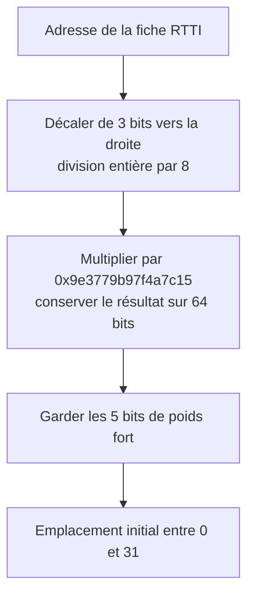
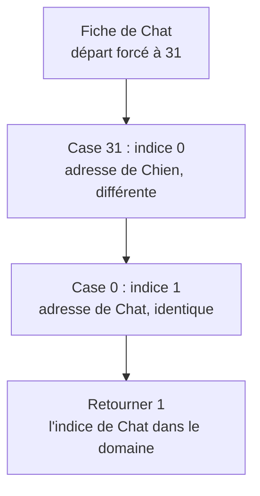

# Retrouver un type avec l'index RTTI

[Sommaire](README.md) · [Précédent : comprendre les tables](tables_dispatch.md)

L'index répond à une seule question : **« Quel numéro correspond au type réel
de cet objet dans ma liste ? »** Ce numéro servira ensuite à choisir une case
de la table de dispatch.

## Commencer avec trois types

```cpp
using Animaux = liste_types<Chien, Chat, Oiseau>;
```

L'ordre de la liste donne `Chien = 0`, `Chat = 1`, `Oiseau = 2`.
Pour un objet `Chat` reçu à travers une référence `Animal&`, `typeid(objet)`
identifie le type réel. Il reste à retrouver l'indice 1.

Une **fiche RTTI** désigne ici l'objet `std::type_info` fourni par C++ pour
identifier un type. Elle décrit le type, pas un animal individuel.

Jusqu'à 8 types, la recherche compare les adresses de ces fiches dans l'ordre :

```text
La fiche reçue est-elle celle de Chien ? Non.
La fiche reçue est-elle celle de Chat ?  Oui → retourner 1.
```

Si aucune adresse ne correspond, un second passage compare les types avec
`std::type_info::operator==`. Si aucun type ne correspond non plus, la recherche
lève `type_inconnu`.

## Passer à neuf types

Au-delà de 8 types, le code crée un raccourci de recherche : un index haché.
Prenons `Chien, Chat, Oiseau, Poisson, Cheval, Vache, Mouton, Lapin, Tortue`,
avec les indices 0 à 8.

L'index contient deux tableaux :

- `types_` conserve les adresses RTTI dans l'ordre de la liste.
- `cases_` contient des indices permettant de retrouver ces adresses rapidement.

**L'indice d'un type et l'emplacement dans `cases_` sont deux numéros différents.**
Une case 13 peut contenir l'indice 1 : elle renvoie alors à `types_[1]`, la fiche
qui décrit `Chat`.

L'index est construit au premier accès et partagé par les méthodes utilisant
la même liste. Il est ensuite seulement consulté. Les types autorisés restent
fixés à la compilation.

## Choisir la taille du tableau

Le projet réserve au moins deux fois le nombre de types, puis arrondit à la
plus petite puissance de deux supérieure ou égale :

```cpp
capacite = std::bit_ceil(2 * nombre_types);
```

| Types | Double | Capacité | Emplacements |
| ---: | ---: | ---: | --- |
| 9 | 18 | 32 | 0 à 31 |
| 16 | 32 | 32 | 0 à 31 |
| 17 | 34 | 64 | 0 à 63 |

Les cases libres limitent la longueur des recherches en cas de collision.
La puissance de deux simplifie le calcul des emplacements avec les bits.
Une case vide contient la sentinelle `nombre_types` : 9 ici, une valeur distincte
et hors des indices autorisés 0 à 8. Ces cases libres ne servent pas à ajouter
des types pendant l'exécution.

## Calculer le hachage sur 64 bits

Le hachage transforme **l'adresse d'une fiche RTTI** en emplacement de départ.
L'adresse de l'objet `chat` lui-même n'intervient pas.

Pour une capacité de 32, le calcul du projet se lit ainsi :



Le décalage écarte trois bits de poids faible, souvent peu utiles à cause de
l'alignement. La multiplication répartit les adresses entre les cases.
Le calcul non signé se fait modulo 2^64 : les bits qui dépassent sont éliminés.
Enfin, cinq bits représentent 32 valeurs. Pour 64 cases, on en conserverait six.

Voici la version pédagogique, avec une adresse numérique fictive :

```cpp
constexpr std::uint64_t melanger(std::uint64_t adresse) {
    return (adresse >> 3) * UINT64_C(0x9e3779b97f4a7c15);
}

// Pour 32 cases : 64 - 5 = 59 bits a retirer a droite.
const auto case_initiale = melanger(0x1000) >> 59; // 13
```

```text
Adresse fictive             : 0x1000, soit 4096
Après division entière par 8: 512
Produit conservé sur 64 bits: 0x6ef372fe94f82a00
Cinq bits de gauche         : 01101, soit 13
```

Le préfixe `0x` indique l'hexadécimal. Dans le vrai moteur,
[hachage_adresse_type](../include/mini_openmethod/detail/index_types.hpp) convertit
l'adresse RTTI en entier. Il utilise la constante `0x9e3779b9` lorsque `size_t`
a 32 bits ; cette démonstration est fixée à 64 bits.

## Résoudre les collisions

Deux adresses peuvent donner le même emplacement initial. Le code avance alors
jusqu'à une case libre : c'est le **sondage linéaire**.

Pour rendre le cas reproductible, les exemples forcent tous les départs à 31 :

```text
Insérer Chien, indice 0 : case 31 libre → écrire 0.
Insérer Chat, indice 1  : case 31 occupée → case 0 libre → écrire 1.
Insérer Oiseau, indice 2: cases 31 et 0 occupées → case 1 libre → écrire 2.
```

Avec 32 cases, la progression utilise `(position + 1) & 31`, équivalent ici à
`(position + 1) % 32`. On passe donc de 31 à 0.

| Emplacement de `cases_` | Indice stocké | Fiche retrouvée via `types_` |
| ---: | ---: | --- |
| 31 | 0 | Chien |
| 0 | 1 | Chat |
| 1 | 2 | Oiseau |

La recherche du chat refait le même parcours :



Le hachage indique où commencer ; la comparaison vérifie qu'il s'agit de la
bonne fiche. Si la recherche atteint une case vide, elle passe à la comparaison
par égalité des types sur toute la liste.

## Plusieurs fiches pour un même type

Le code prévoit que des fiches à des adresses différentes puissent décrire le
même type, notamment entre bibliothèques partagées. Supposons que l'index ait
retenu la fiche de `Chat` à `0x1000`, mais que l'objet reçu fournisse une fiche
équivalente à `0x3000`. Leurs hachages donnent respectivement 13 et 9.

La recherche par adresse ne trouve pas `0x3000`. Le passage par égalité des types
reconnaît ensuite `Chat` et retourne toujours son indice 1.

```cpp
&fiche_recue == &fiche_enregistree; // Meme adresse ?
fiche_recue == fiche_enregistree;   // Meme type, via operator== ?
```

Des adresses différentes ne prouvent donc pas que les types sont différents.

Un programme C++ ordinaire ne peut pas fabriquer de façon portable deux objets
`std::type_info` représentant le même type à des adresses choisies.
L'exemple 08 ne prétend donc pas constituer un test d'intégration entre DLL.

Il remplace une fiche par cette représentation pédagogique :

```cpp
struct Fiche_simulee {
    std::uint64_t adresse;
    std::string_view type;
};
```

Les nombres ne sont jamais convertis en pointeurs ni déréférencés. Le champ
`type` modélise une identité : le vrai moteur compare `std::type_info` avec
`operator==`, et non les noms retournés par `name()`.

| Adresse reçue / adresse connue | Type reçu / type connu | Issue |
| --- | --- | --- |
| Identique | Identique | Retour de l'indice par comparaison d'adresses |
| Différente | Identique | Recherche par adresse infructueuse, puis retour de l'indice par égalité de type |
| Différente | Différent | Chercher les autres types ; si aucun ne correspond, `type_inconnu` |
| Identique | Différent | Hypothèse incohérente : une même fiche vivante ne représente pas deux types différents |

Le dernier cas est rejeté par `std::invalid_argument` **uniquement dans la
simulation**, pour éviter une démonstration trompeuse. Ce contrôle supplémentaire
n'existe pas dans le moteur réel. Une collision de hachage, en revanche, est
parfaitement possible entre des adresses différentes et n'est pas une erreur.

La simulation vérifie les neuf types, chacun avec son adresse enregistrée et
une autre adresse représentant le même type, avec le hachage normal puis avec
les collisions forcées : **9 × 2 × 2 = 36 recherches connues**. Elle vérifie
aussi un type inconnu dans les deux modes et affiche le retour de 31 à 0.

## Exécuter les exemples et observer les erreurs

- [07_indexation_rtti.cpp](../exemples/07_indexation_rtti.cpp) utilise la vraie bibliothèque.
- [08_simulation_fiches_rtti.cpp](../exemples/08_simulation_fiches_rtti.cpp) utilise
  les adresses fictives et affiche les parcours.

Les erreurs attendues sont interceptées ; une erreur manquante ou un résultat
incorrect termine le programme avec 1, y compris en Release. Les `static_assert`
de la simulation contrôlent les capacités et les calculs `0x1000 → 13` et
`0x3000 → 9`. Les cas couvrent les issues de l'algorithme, pas toutes les adresses possibles.

Le premier programme vérifie les trois types du petit domaine, puis les neuf
types du grand domaine : `Chien`, `Chat`, `Oiseau`, `Poisson`, `Cheval`, `Vache`,
`Mouton`, `Lapin`, `Tortue`. Leur indice est leur position, de 0 à 8.

| Situation | Résultat attendu |
| --- | --- |
| Un des trois types du petit domaine | Recherche linéaire, indice 0 à 2 |
| Un des neuf types du grand domaine | Recherche hachée, indice 0 à 8 |
| Toutes les adresses hachées dans la dernière case | Collisions résolues, indices inchangés |
| Sondage qui dépasse la dernière case | Retour de 31 à 0, recherche poursuivie |
| Deux objets `Chat` distincts | Même type et même indice 1 |
| Objet connu préparé | Même résultat que l'appel sur l'objet brut |
| Objet de type exact `Animal` | `type_inconnu` : la racine n'est pas dans les listes |
| `Loup`, dérivé de `Chien` | `type_inconnu` : ce descendant n'est pas dans les listes |
| `Tortue` recherchée dans le petit domaine | `type_inconnu`, même si le grand domaine l'accepte |
| Préparation d'un type inconnu | `type_inconnu` dès `preparer` |

Le hachage forcé sert uniquement à montrer les collisions : il renvoie un entier
dont tous les bits valent 1. Le vrai index choisit donc sa dernière case.
Les neuf indices sont insérés dans les cases `31, 0, 1, 2, 3, 4, 5, 6, 7`.
L'exemple utilise pour cela `detail::index_types`, un détail interne de la
bibliothèque, pas un nouveau contrat public.

Le programme parcourt aussi **tous les couples** de l'ensemble
`{Chien, Chat, Loup}`, pour une méthode dont les domaines restent `{Chien, Chat}` :

| Premier / second | Chien | Chat | Loup |
| --- | --- | --- | --- |
| Chien | observation | poursuite | `type_inconnu` |
| Chat | prudence | observation | `type_inconnu` |
| Loup | `type_inconnu` | `type_inconnu` | `type_inconnu` |

Les quatre couples autorisés sont aussi vérifiés avec des références préparées.
La spécialisation générale `(Animal, Animal)` ne permet pas d'accepter `Loup` :
le contrôle du type exact a lieu avant l'appel de cette spécialisation.

## Erreurs de compilation

Ces cas ne peuvent pas être placés dans le même exécutable que les exemples
valides : ils empêchent précisément sa compilation. CTest compile les fichiers
de refus séparément et vérifie le diagnostic attendu. La page
[Comprendre une erreur](reference.md#comprendre-une-erreur) regroupe les messages,
leurs causes, les corrections et les liens vers ces programmes.

Un type inconnu lors d'un appel est une erreur d'exécution ; une combinaison
déclarée mais non couverte est une erreur de compilation.

## Lancer les programmes

Suivre d'abord le [guide de compilation](construction.md). Les deux exemples
sont enregistrés dans CTest. Depuis la racine, après compilation, afficher
uniquement leurs traces :

```powershell
ctest --test-dir build -C Release -V -R 'exemple_0[78]_'
```

Avec le préréglage LLVM, remplacer `build` par `build-llvm`.
La simulation n'inclut que la bibliothèque standard et peut aussi être compilée seule :

```sh
c++ -std=c++23 -Wall -Wextra -Wpedantic exemples/08_simulation_fiches_rtti.cpp -o simulation_rtti
./simulation_rtti
```

Pour approfondir le code, poursuivre avec l'[architecture](architecture.md).
