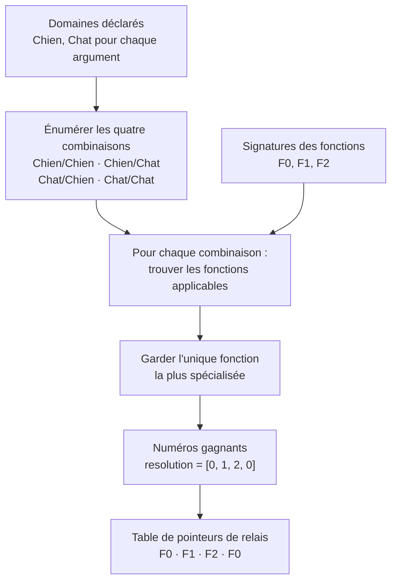
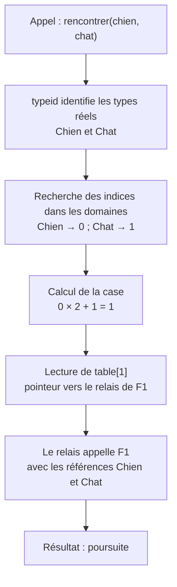

# Comprendre les tables de dispatch

[Sommaire](README.md) · [Précédent : utiliser la bibliothèque](utilisation.md)

Le **dispatch** est le choix de la fonction à appeler. Dans mini-openmethod,
la bonne fonction est choisie **à la compilation pour chaque combinaison de
types déclarée**. À l'exécution, il reste à identifier les objets et à lire
la case correspondante.

## Partir de deux animaux

Prenons l'[exemple 03](../exemples/03_dispatch_double.cpp). Les deux arguments
peuvent être un `Chien` ou un `Chat`, tous deux dérivés de `Animal`.

```cpp
using Animaux = liste_types<Chien, Chat>;

auto rencontrer = creer_methode<std::string_view(const Animal&, const Animal&)>(
    domaines<Animaux, Animaux>{},
    [](const Animal&, const Animal&) -> std::string_view { return "observation"; },
    [](const Chien&, const Chat&) -> std::string_view { return "poursuite"; },
    [](const Chat&, const Chien&) -> std::string_view { return "prudence"; });
```

Une **spécialisation** est une de ces fonctions, avec ses paramètres plus ou
moins précis. Numérotons-les dans leur ordre de déclaration :

| Numéro | Paramètres | Résultat |
| --- | --- | --- |
| F0 | `const Animal&, const Animal&` | observation |
| F1 | `const Chien&, const Chat&` | poursuite |
| F2 | `const Chat&, const Chien&` | prudence |

Ces numéros servent à retrouver les fonctions ; l'ordre de déclaration ne donne
aucune priorité à une spécialisation.

## Construire toutes les cases à la compilation



1. **Numéroter les types.** Dans `liste_types<Chien, Chat>`, `Chien` reçoit
   l'indice 0 et `Chat` l'indice 1. C'est l'ordre de la liste qui fixe ces indices.
2. **Énumérer les couples.** Deux types pour chaque argument donnent `2 × 2 = 4` cases.
3. **Choisir la fonction.** Pour `Chien, Chat`, F0 et F1 sont applicables : les
   deux objets peuvent être vus comme des `Animal`. F1 gagne car elle est plus précise.
4. **Enregistrer un pointeur de relais.** Le relais est une petite fonction qui
   ajuste les références vers les paramètres attendus, puis appelle la spécialisation.

La table se lit comme cette matrice :

| Premier argument / second argument | Chien — indice 0 | Chat — indice 1 |
| --- | --- | --- |
| **Chien — indice 0** | F0 : observation | F1 : poursuite |
| **Chat — indice 1** | F2 : prudence | F0 : observation |

Pour `Chien, Chien`, seule F0 est applicable. Il n'est pas nécessaire d'écrire
une fonction spécifique pour chaque case si une fonction générale la couvre.

**S'il manque une fonction applicable, ou si plusieurs restent maximales,
la compilation échoue.** Pour départager deux fonctions, l'une doit être au
moins aussi précise sur chaque position polymorphe et strictement plus précise
sur au moins une. Une priorité à gauche ou la première fonction déclarée ne
départage pas une ambiguïté.

## Utiliser la table pendant un appel

La matrice est stockée dans un tableau à une dimension. Avec des domaines de
tailles `N` et `M`, le couple d'indices `(i, j)` correspond à :

```text
case = i × M + j
```

Voici le parcours de `rencontrer(chien, chat)` :



Le choix entre les spécialisations n'est pas refait pendant l'appel.
Pour un seul argument polymorphe, on utilise directement son indice.
Les arguments ordinaires, comme un montant ou un flux, ne créent aucune
dimension supplémentaire.

## Distinguer les deux recherches

La recherche du **type** et la lecture de la **fonction** ont des rôles différents :

| Structure | Question résolue | Construction |
| --- | --- | --- |
| Index des types | « Quel indice correspond au type réel de cet objet ? » | Recherche directe jusqu'à 8 types ; au-delà, index haché construit au premier accès |
| Table de dispatch | « Quelle fonction appeler pour ces indices ? » | Calculée à la compilation pour toutes les combinaisons |

La table de dispatch est `static constexpr` et partagée par les objets du même
type de méthode. Chaque objet méthode garde ses propres fonctions et captures.
Le relais reçoit cet objet méthode pour appeler la bonne fonction avec ses captures.

L'index haché est partagé par les méthodes utilisant la même liste de types.
Il est rempli une fois puis seulement consulté. Les types possibles restent
fixés à la compilation ; les cases libres ne permettent pas d'en ajouter à chaud.

## Ce qui arrive en cas d'erreur

| Situation | Moment | Résultat |
| --- | --- | --- |
| Une combinaison déclarée n'est pas couverte | Compilation | Diagnostic « sans spécialisation applicable » |
| Plusieurs spécialisations restent maximales | Compilation | Diagnostic d'ambiguïté |
| Un objet a un type absent de sa liste | Exécution | Exception `type_inconnu` |

Par exemple, un `Loup` dérivé de `Chien` reste refusé si la liste est seulement
`Chien, Chat`. La fonction générale `(Animal, Animal)` ne contourne pas ce contrôle.

Avec `preparer(objet)`, on identifie le type une fois et on conserve son indice
avec une référence à l'objet. Les appels suivants lisent cet indice directement.
L'objet doit rester vivant à la même adresse et conserver son type dynamique.

**Suite :** [suivre l'index RTTI, le hachage et les collisions avec des exemples](exemples_indexation_rtti.md).
Pour retrouver les étapes dans le code : [construction et appel](../include/mini_openmethod/methode.hpp)
et [résolution C++23](../include/mini_openmethod/detail/resolution_cpp23.hpp).
